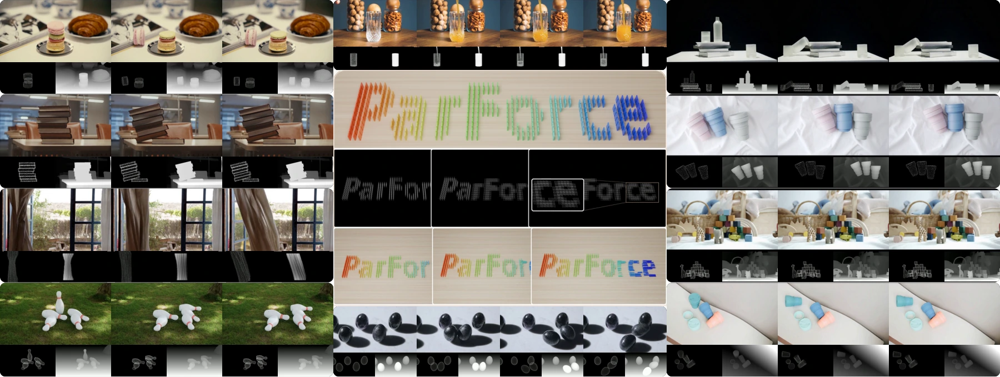
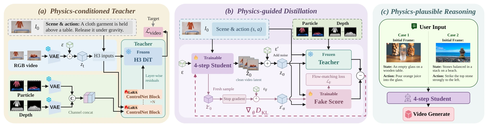

<h1 align="center">Particle Forcing</h1>
<p align="center"><strong>Guiding Spatio-Temporal Layouts, Learning Physics-Aware Generation</strong></p>

<p align="center">
  Liang Dong<sup>1</sup>, Haowen Xu<sup>2</sup>, Tieyue Yin<sup>3</sup>, Yunfeng Wu<sup>4</sup>,<br>
  Jun Sun<sup>3</sup>, Songhua Liu<sup>2,*</sup>, Yingtian Zou<sup>2,*</sup>
</p>

<p align="center">
  <sup>1</sup> Carnegie Mellon University · <sup>2</sup> Shanghai Jiao Tong University<br>
  <sup>3</sup> Nanjing University · <sup>4</sup> The University of Hong Kong<br>
  <small>* Corresponding authors</small>
</p>

<p align="center">
  <a href="https://brady-png.github.io/parforce-project/"><strong>Project page</strong></a> ·
  <a href="https://brady-png.github.io/parforce-project/assets/paper.pdf"><strong>Paper</strong></a> ·
  <a href="https://huggingface.co/BRADY99/ParForce"><strong>Model weights</strong></a> ·
  <a href="#quick-start"><strong>Quick start</strong></a>
</p>

<p align="center">
  
</p>

ParForce uses projected particles and surface depth to guide motion and occlusion. A distilled four-step student generates video from a first frame and text.

## Method



| Component | Inputs | Output |
| --- | --- | --- |
| Physical condition constructor | First frame and action, with prepared actor perception for rigid scenes | Projected particle states and visible surface depth |
| ParForce Teacher | First frame, prompt, particles, and depth | Motion-controlled RGB video |
| ParForce Student | First frame and prompt | RGB video in four denoiser calls |

During distillation, the teacher supplies guidance from particle and depth sequences while the student learns to generate from the first frame and text.

## Quick start

### 1. Prepare the environment

Use an Ascend NPU environment with Python 3.12, CANN 9.0.1, PyTorch 2.7.1 and matching `torch_npu`. The inference entry points were smoke-tested on four Ascend 910B devices. Initialize CANN and install FFmpeg with libx264. The [bundled runtime](runtime/README.md) provides the VideoX-Fun source used by the launchers.

```bash
git clone https://github.com/Brady-png/ParForce.git
cd ParForce

python -m pip install "huggingface_hub[cli]" pillow numpy opencv-python-headless \
  diffusers==0.40.0 transformers==5.14.1 peft==0.20.0 \
  safetensors==0.8.0 tokenizers==0.22.2
```

### 2. Download the base and adapters

| Model | Download | Inputs |
| --- | --- | --- |
| MiniMax-H3 FL2VA | [Upstream base](https://huggingface.co/MiniMaxAI/MiniMax-H3/tree/main/FL2VA) | Shared base for both commands |
| ParForce H3 Teacher | [Teacher adapter](https://huggingface.co/BRADY99/ParForce/blob/main/conditioned_models/parforce_h3_conditioned.safetensors) · [Union 2.0](https://huggingface.co/alibaba-pai/MiniMax-H3-Fun-Controlnet-Union-2.0) | First frame, prompt, particles, depth |
| ParForce H3 Student | [Student adapter](https://huggingface.co/BRADY99/ParForce/blob/main/parforce_h3_student.safetensors) | First frame and prompt |

```bash
hf download MiniMaxAI/MiniMax-H3 --include 'FL2VA/*' --local-dir weights/minimax-h3
hf download BRADY99/ParForce \
  conditioned_models/parforce_h3_conditioned.safetensors \
  parforce_h3_student.safetensors --local-dir weights/parforce
hf download alibaba-pai/MiniMax-H3-Fun-Controlnet-Union-2.0 \
  MiniMax-H3-Fun-Controlnet-Union-2.0.safetensors --local-dir weights/union
```

### 3. Run Teacher inference

```bash
input_dir=/path/to/teacher-inputs
python infer.py teacher --base weights/minimax-h3/FL2VA --runtime runtime \
  --adapter weights/parforce/conditioned_models/parforce_h3_conditioned.safetensors \
  --control weights/union/MiniMax-H3-Fun-Controlnet-Union-2.0.safetensors \
  --first-frame "$input_dir/first_frame.png" --prompt-file "$input_dir/prompt.txt" \
  --particle "$input_dir/particles.mp4" --depth "$input_dir/depth.mp4" \
  --work-dir runs/teacher --devices 4 --seed 42
```

Output is `runs/teacher/outputs/result.mp4`. Use your own first frame, prompt, particle video and depth video. Keep the first frame and both control videos registered to the same camera view.

### 4. Run four-step Student inference

```bash
input_dir=/path/to/student-inputs
python infer.py student --base weights/minimax-h3/FL2VA --runtime runtime \
  --adapter weights/parforce/parforce_h3_student.safetensors \
  --first-frame "$input_dir/first_frame.png" --prompt-file "$input_dir/prompt.txt" \
  --work-dir runs/student --devices 4 --seed 42
```

Output is `runs/student/outputs/student/result.mp4`. Use your own first frame and prompt. Both launchers write inference receipts beside the video. Use a fresh work directory per run.

## Condition rendering

The constructor produces synchronized `particles.mp4` and `depth.mp4` from the simulated state and a shared camera. It uses OpenCV, NumPy, SciPy, Pillow, trimesh, Numba, MuJoCo, and FFmpeg with libx264.

### Cloth and pouring from a first frame

Supported cloth actions include local grips, folds, returning lifted edges to the support, and wind on attached cloth. The liquid route pours into a stationary vessel and can preserve a visible initial fill or stream. The simulator represents the liquid's geometry and flow. Its color and appearance come from the text passed to the video generator.

Create `inputs.json` with a unique case ID, a 384 × 256 RGB frame, and the original text for each case. Image paths are relative to the manifest.

```json
[
  {
    "case": "cloth_fold",
    "image": "first_frame.png",
    "prompt": "Initial Scene: A towel lies on a table. External Force: Lift its left edge and fold it toward the right."
  }
]
```

The offline agent uses a local [Qwen3.5-122B-A10B](https://huggingface.co/Qwen/Qwen3.5-122B-A10B) checkpoint. Download the revision listed in the [checkpoint manifest](parforce/conditions/policies/qwen-weights.json). Use Transformers with `Qwen3_5MoeForConditionalGeneration`, Accelerate, and a compatible Ascend PyTorch runtime. The verified BF16 configuration uses five 64 GiB Ascend devices.

```bash
python -m parforce.conditions.verify_checkpoint /path/to/qwen-checkpoint
python -m parforce.conditions.material_agent \
  --manifest inputs.json --model /path/to/qwen-checkpoint \
  --output runs/material-conditions --devices 5 --rounds 4 --batched-npu-experts
```

Each accepted attempt has a compiled plan, solver states, both condition videos, and a review record. Review the initial alignment, action, physical continuity, and agreement between the two videos before supplying them to the teacher.

### Rendering prepared plans

The renderer runs on CPU with a prepared rigid, cloth, or pouring plan. Rigid plans supply masks, camera-space depth, and action fields. Use a fresh output directory. The result reports technical checks for each condition pair.

```bash
python -m parforce.conditions.run --manifest plans.json --output runs/conditions
```

## Model terms

The upstream models and runtime retain their own terms. [MiniMax-H3 license](https://huggingface.co/MiniMaxAI/MiniMax-H3/blob/main/LICENSE) · [Union 2.0 license](https://huggingface.co/alibaba-pai/MiniMax-H3-Fun-Controlnet-Union-2.0/blob/main/LICENSE) · [VideoX-Fun license](runtime/licenses/VideoX-Fun-LICENSE.txt)
